# YAAC — Yet Another Agent Controller

**One window to drive Codex and Claude Code: on this machine, on your servers over SSH, and inside
WSL. Your agents can message, start and wait for each other, across harnesses and machines.**

YAAC does not implement an agent. It drives the harnesses you already use, where your code lives,
and gives every agent the tools to work with the others. A Codex thread can hand work to three
Claude workers on a GPU box, wait for them, and tell a thread on another server when it is done.
You see every message they exchange, in both transcripts.

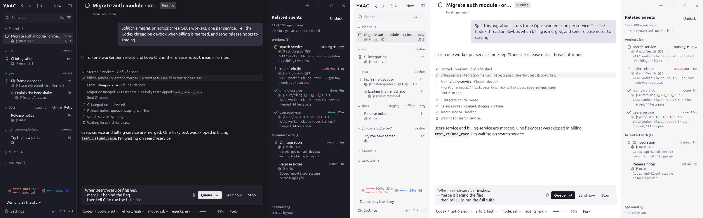

<sub>Every screenshot shows the dark theme on the left and the light theme on the right. All data is
the built-in demo (`yaac --demo`).</sub>

- **Native and small.** A Rust window drawn with egui (GPU, or software when there is no GPU), plus a
  native WPF front end on Windows. It uses no CPU while idle and reads from a local cache on start.
- **One connection per target.** Each machine gets one SSH session or one `wsl.exe`, and nothing
  else. Every thread, upload, terminal and browser tab is multiplexed over it.
- **Nothing is lost while you are away.** Turns keep running when the window closes. The daemon on
  each target (`yaacd`) journals every event, and a headless hub keeps carrying messages between
  machines.
- **Nothing about models is hardcoded.** Models, effort levels and what each model can do come from
  the target at runtime.

**Contents:** [Feature tour](#feature-tour) · [Native Windows front end](#the-native-windows-front-end-wpf) ·
[Install](#install) · [Where the UI runs](#where-the-ui-runs) ·
[Extending to Linux and macOS](#extending-to-linux-and-macos) · [Building](#building-from-source) ·
[Status and docs](#project-status-and-documentation)

## Feature tour

### The agent mesh

Every thread gets one MCP server, `yaac`, with a small set of tools: `list_targets`, `list_models`,
`list_threads`, `find_thread`, `read_thread`, `spawn_thread`, `send_message` (queued or now),
`wait`, `notify_when_done` and `stop_thread`. Each agent is told it has them. So "spawn three Opus
workers for these modules", asked of a Codex thread, works. So does "tell the thread on devbox when
you're done".

Messages are durable at every hop: each one is written to disk before it is acknowledged. They are
addressed, never broadcast. The sender is stamped by `yaacd`, so an agent cannot forge it. A
message from an agent is never shown as coming from you, and never answers an approval meant for
you. Messages between threads on one target go straight through its `yaacd`. Messages between
targets go through the hub on your computer. The mesh also covers the pull requests of a branch
and the in-app browser (see [the side pane](#the-side-pane-browser-files-diffs-terminal)).
→ [docs/10-agent-mesh.md](docs/10-agent-mesh.md)

### Related agents: pill, card, dock, and the budget

A thread that has a parent, workers or contacts shows a narrow **pill** on the right edge of the
chat. It has one icon per related agent, in three clusters: *spawned by*, *workers* and *in
contact with*. Small arrows show messages in flight, and a red mark shows an agent that needs you.
Hover over the pill and it becomes a **card**. **Dock** it and it becomes a resizable panel listing
each agent's state, branch, git changes, provider, model, target and latest activity. Rest on a
row for two seconds to preview that agent's transcript without leaving your thread. Harness
sub-agents (Claude Code's and Codex's own) are listed next to YAAC workers.

Every orchestration has a **budget**: the turns its agents start, and the time since a person last
acted on it. When the budget runs out nothing is cancelled. Running turns finish, further agent
messages wait, and one **Continue** grants another allowance. You set it in the chat's *agents:
ask / allow* control and its permission prompt.

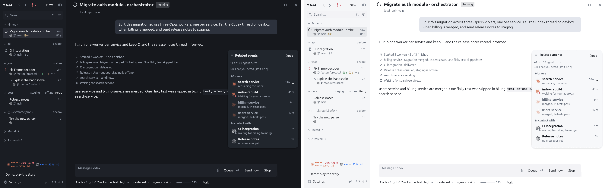

### Threads and the sidebar

A thread is one conversation of one provider. The sidebar is a flat list under sticky headers,
grouped by machine, project and worktree, each level switchable. Every row shows its state, git
branch, files added, modified and deleted, unpushed and unpulled commits, and how many workers it
has. Threads that need you float to the top with a red mark, and **Ctrl+J** cycles through them.
You can pin, mute (with a duration), archive, search, multi-select, and move threads between
projects. YAAC also finds sessions you started in a terminal. A thread in use by another program is
shown live and read-only until you **Take over**. The sidebar collapses to a narrow strip.

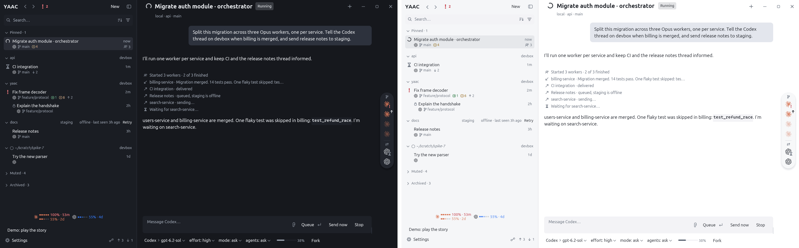

### The composer

- **Queue or send now.** While a turn runs, Enter queues the message. The queue is held by the
  daemon, so it is delivered even if the window is closed. **Send now** (Ctrl+Enter) steers the
  running turn where the harness can, and otherwise interrupts it and says so. Queued messages can
  be edited, cancelled or sent now.
- **`!` commands.** A draft starting with `!` runs as a shell command on the thread's target, in
  its folder, and then the agent answers it. ↑ recalls earlier commands.
- **Attachments and images.** Paste or drop files and images. Each becomes a chip with upload
  progress. An image is sent as image input only when the thread's model can see images. If the
  model cannot, the chip says it will go as a file. If YAAC cannot tell, it asks you.
- Markdown is styled as you type. `@` searches files on the target, `/` and `$` open the thread's
  skills, and `/compact` compacts the context. Drafts survive restarts. The row under the composer
  holds model, effort, speed (Fast / Ultrafast), permission mode, *agents: ask/allow*, Fork and
  the context meter. Each control appears only where the harness offers it.

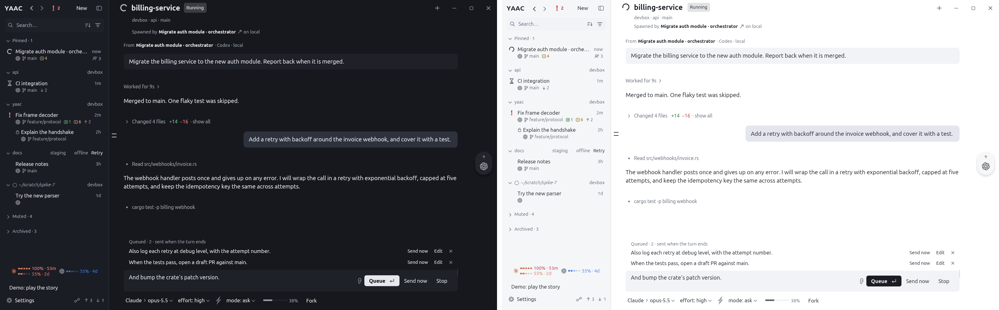

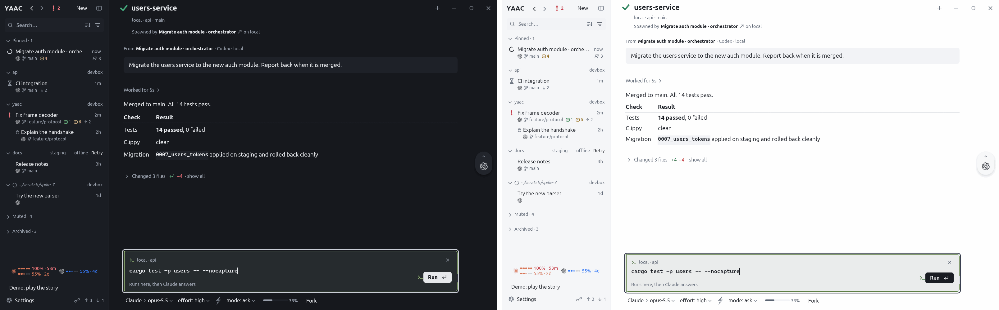

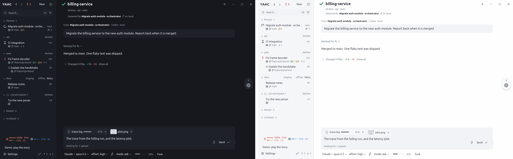

### Approvals and questions

When an agent asks to run a command or edit files, or asks you a question, the request is written
to disk on the target before anything else happens to it. It is never dropped, auto-answered or
timed out. Approval keys act only on the card that has focus, so pressing Enter in the composer
never approves anything. If the connection drops while you answer, the card says the outcome is
unknown and never sends the answer again. The one exception is a thread you put in the harness's
never-ask mode: there YAAC approves tool calls, records each one and shows it.

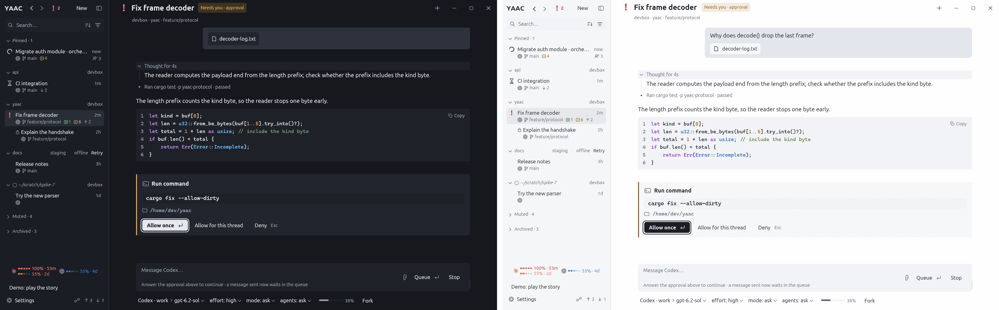

### Fork and handoff

Models can change within a thread, providers cannot. To continue elsewhere, **fork**. A fork on the
same provider is native. A fork to another provider is a handoff: YAAC states what will be carried
over and what will not, previews the transcript the new agent will receive, and asks for its first
message.

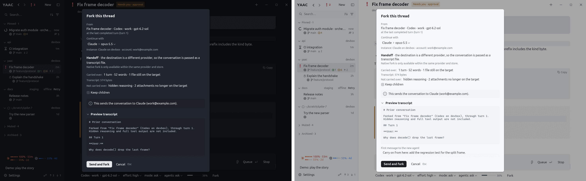

### The side pane: browser, files, diffs, terminal

The **+** in the title bar opens a side pane for the open thread, split from the chat, with its own
tabs:

- **Browser.** An embedded Chromium (CEF) that sees the network as the target does. Through the
  target's one connection, `http://localhost:5173/` is the dev server *on that target*. It has
  DevTools in their own window, a list of the target's listening ports, and **Open in browser**.
  Agents can drive tabs too: open, navigate, snapshot, click, type, press, eval, screenshot, and
  read the console and network. A tab an agent is driving carries its harness mark.
- **Files, File and Diff.** The worktree tree with git marks, read-only file views with syntax
  colours, and unified or side-by-side diffs. Select lines and **Add to composer** (Ctrl+Shift+A)
  to quote them with their path and line range.
- **Terminal.** A fast terminal on the target: PowerShell on Windows, your login shell on Linux and
  macOS. Terminal tabs live in the side pane, and a **terminal panel** sits under the composer
  (Ctrl+`). It handles full-screen programs like `vim`, `htop` and `tmux`.

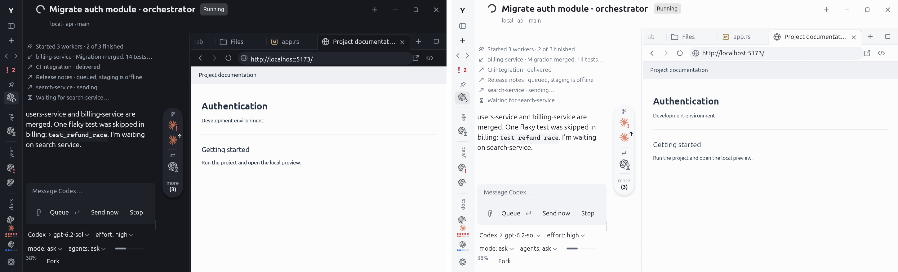

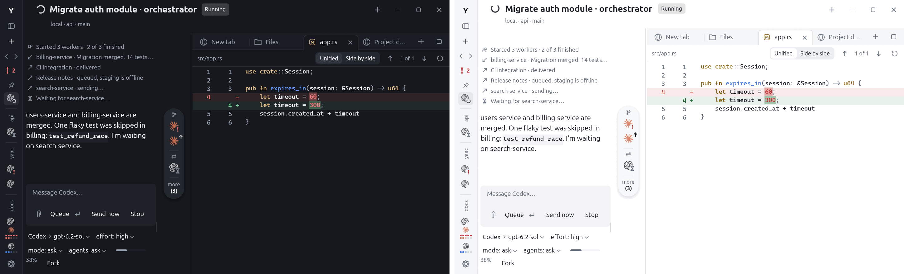

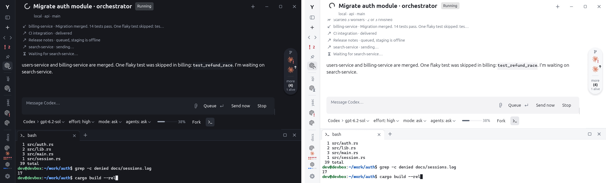

### Pull requests

A row whose branch has an open pull request on GitHub (through `gh`) or Azure DevOps (through `az`)
shows a `PR#` badge. The badge marks drafts, merged and closed pull requests, and failing or running
checks. **Create pull request…** pre-fills title and description from the commits, or asks the
agent to write them. It also warns when the branch has to be pushed first. Agents get the same
pull request tools through the mesh.

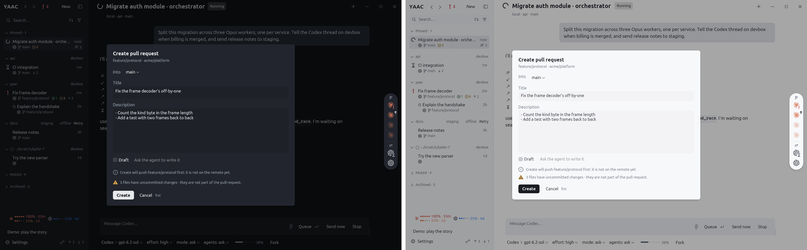

### Rate limits

The bottom of the sidebar shows the plan rate limits of every account your targets use. Each window
shows as a bar with the share used and the time until reset. An account used on several targets
appears once. Hover for exact values and reset times in your local time.

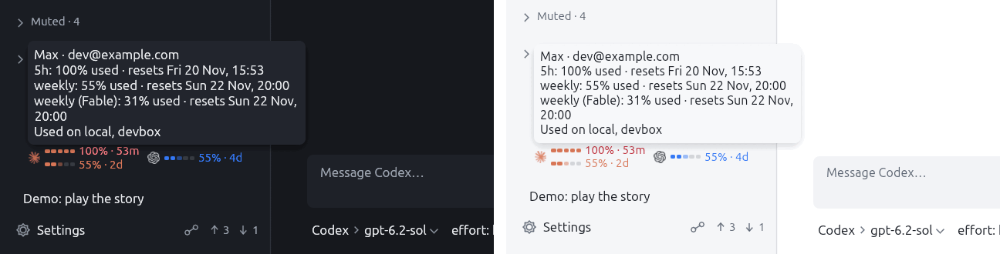

### Commander and rebindable keys

**Ctrl+Space** opens the Commander, which searches every command the window has: jumps, thread
actions, model and mode changes, settings pages and related agents. Commands that take an argument
continue in place. **Settings → Keyboard** rebinds any key, flags conflicts, and lets chosen
commands reach YAAC while a terminal has focus.

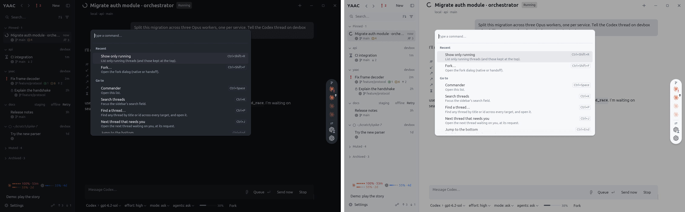

### Targets: local, SSH, WSL

A target is a user on a machine: **this computer**, any number of **SSH** servers (Linux, and macOS
as a side effect), and any number of **WSL** distros (on Windows hosts). Guided SSH setup makes
access password-less with a key YAAC generates. The password is used once, in memory, and never
stored. **Revoke** removes only what YAAC added. `yaacd` installs itself on first connect,
together with its own Node.js runtime, so a target needs nothing but the harness CLIs, signed in.
A stopped WSL distro is never started behind your back.

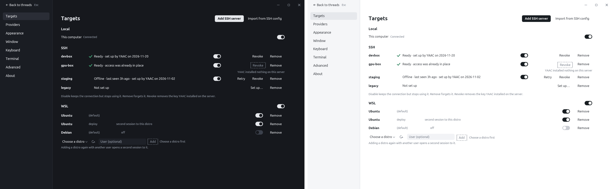

### The hub: it keeps working with the window closed

`yaac hub` is the headless half of YAAC. It owns the connection to every target, routes mesh
messages between machines through a durable relay queue, and starts at login. Close the window and
your agents keep messaging and spawning each other. Open it again and everything that happened is
there. On Windows the window can also stay in the tray. The tray icon shows a badge when a thread
needs you.

### Themes, renderers and updates

Dark, light, or follow the system, and a font size. **Settings → Window** chooses the renderer
(OpenGL, Direct3D 12, Vulkan, software, or Windows WPF) and says what is actually in use, including
any fallback. On Windows, YAAC checks GitHub Releases at start and every ten minutes, verifies the
installer against the release manifest, and installs when you say so. The hub then updates each
target's `yaacd` once it is idle.

## The native Windows front end (WPF)

On Windows, YAAC can also draw itself with **WPF**: the same Rust controller, the same hub
connection, the same features, drawn with native Fluent controls in software. It suits machines
where GPU rendering is a problem, such as VMs and remote desktops. Choose **Windows WPF** in
**Settings → Window → Renderer**, or start once with `yaac.exe --renderer windows-wpf`. The
installer includes its .NET runtime. Try it with demo data: `yaac.exe --demo fleet --renderer
windows-wpf`.

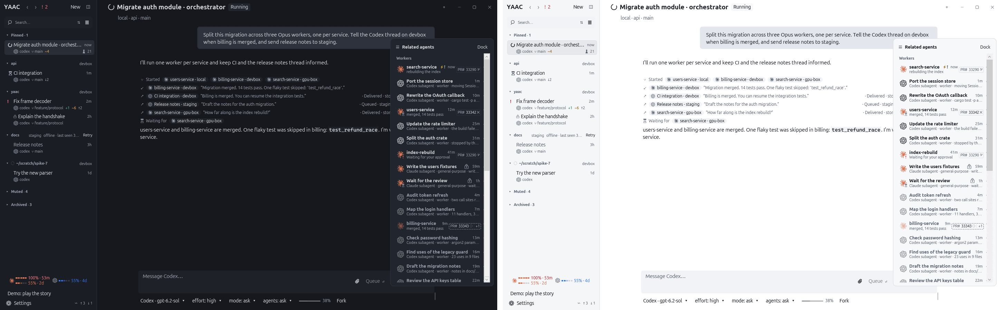

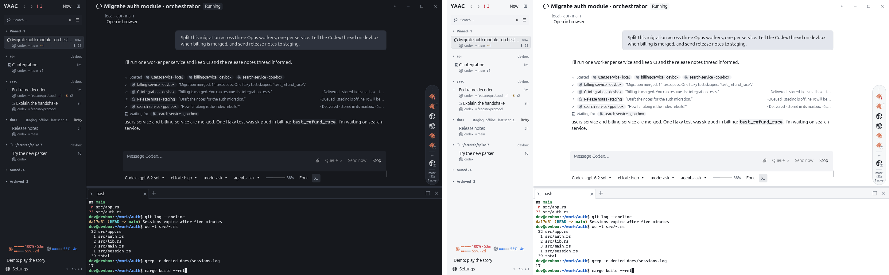

## Install

**Windows:** download `YAAC-Setup-<version>-build.<id>.exe` from the
[latest release](https://github.com/lelemm/yaac/releases/latest). It installs per user, without
administrator rights. The installer is not code-signed yet, so SmartScreen asks once (*More info →
Run anyway*). What goes where, the login entry, upgrades and uninstall:
[docs/install.md](docs/install.md).

**Linux:** no package yet. [Build from source](#building-from-source).

Then install the harnesses you want on each target (`codex`, `claude`) and sign in to them there.
YAAC installs `yaacd` on its own.

## Where the UI runs

| Host | Front ends | Status |
| --- | --- | --- |
| **Windows 10/11** | egui on OpenGL (glow), or wgpu on Direct3D 12, Vulkan or OpenGL. Software fallback on WARP. Native **WPF** front end. | The released, packaged platform: installer, tray, single-instance window, hub at login, in-app updater, embedded browser. Targets: local Windows, SSH, WSL. |
| **Linux** | egui (glow or wgpu; software through lavapipe/llvmpipe), on X11 or Wayland. | Developed and tested under **WSLg** (Weston), not on a native desktop. The hub, Unix-socket attach, XDG autostart and `notify-send` notifications are implemented and covered by the Linux test suite. No tray and no updater, and **no package**: build from source. The embedded browser needs a CEF runtime you stage yourself ([crate guide](crates/yaac-preview/README.md)). Targets: local Linux and SSH. |
| **macOS** | egui (glow or wgpu, through eframe). | Not packaged or tested. The code keeps macOS in mind in a few places (paths under `~/Library/Application Support`, `open` for URLs, Node.js runtimes for Darwin targets), but nobody runs it. |

### Extending to Linux and macOS

**The short answer:** the core already runs on Linux, so the remaining work is mostly packaging and
desktop integration. macOS needs the same, plus Apple's signing and bundle rules, and a different
layout for the browser host.

What is already portable:

- The window is **eframe/egui**, cross-platform by design, with glow and wgpu built in.
- `yaac-core`, `yaac-protocol`, `yaac-term` (the terminal emulator) and `yaac-code` (syntax
  colouring) have no platform code. The whole Rust test suite runs on Linux in CI
  (`.github/workflows/release.yml`).
- The hub's attach channel is a Unix socket (`0600` in a `0700` directory) on Unix and a named pipe
  on Windows (`crates/yaac-hub/src/server.rs`, `client.rs`). The SSH askpass helper has the same
  split (`crates/yaac-hub/src/ssh/askpass.rs`).
- **No keychain is needed.** YAAC stores no passwords and no harness credentials. The only secret
  it keeps is a key it generated for an SSH connection, in a user-only file
  ([02-architecture](docs/02-architecture.md)). Nothing waits on a macOS Keychain or Secret
  Service port.
- Targets are independent of the host. `yaacd` already ships Node.js checksums for Linux (glibc
  and musl) and macOS (x64 and arm64) (`crates/yaac-transport/src/runtime.rs`), so macOS and Linux
  machines work as SSH targets today.

What is Windows-only, and what each piece would need:

| Piece | Where | Linux | macOS | Effort |
| --- | --- | --- | --- | --- |
| **Packaging** | `installer/yaac.iss` (Inno Setup), `scripts/build-installer.sh`, release workflow builds only `x86_64-pc-windows-gnu` | AppImage, `.deb`/`.rpm` or Flatpak, plus a Linux job in the release workflow | A `.app` bundle and a `.dmg`, **code signing and notarisation** (Apple Developer ID), universal or per-arch builds | Linux small–medium · macOS medium |
| **Updater** | `crates/yaac-app/src/updater.rs` (compiled everywhere, started only on Windows; it runs the Inno installer) | Per-format: let the package manager or AppImage update handle it, or extend the manifest with Linux artefacts | Sparkle-style flow, or download a signed `.dmg` | small–medium |
| **Tray** | `crates/yaac-app/src/tray.rs`; `tray-icon` is a Windows-only dependency in `crates/yaac-app/Cargo.toml` | `tray-icon`'s `ksni` (StatusNotifier) backend, with a check that a StatusNotifier host exists (P74; WSLg has none) | `tray-icon` supports the macOS menu bar; enable it and test hide-on-close | small |
| **Login start for the hub** | `crates/yaac-hub/src/autostart.rs`: Windows `Run` key, XDG `.desktop` elsewhere | Done (XDG autostart) | Needs a `launchd` LaunchAgent plist: today macOS would get the XDG file, which does nothing there | small |
| **Hub notifications** (a thread needs you, no window open) | `crates/yaac-hub/src/notify.rs` | Done (`notify-send`); Windows toasts are not implemented yet either | Not implemented (`osascript` or `UserNotifications`) | small |
| **Single instance and quit signal** | `crates/yaac-winsys` (Windows named event) and `tray.rs` | A lock or socket next to the hub's | Same as Linux | small |
| **Embedded browser (CEF)** | `crates/yaac-preview`, `scripts/build-preview-runtime.sh` / `stage-cef-runtime.sh` (`linux64` and `windows64` only) | Works for development. Needs the ~333 MB runtime packaged with the app | CEF on macOS requires a framework bundle and separate helper `.app`s, signed and notarised; the host would need a new launch path | Linux medium · macOS large |
| **WPF front end** | `tools/wpf-preview`, `crates/yaac-app/src/wpf.rs` | Not applicable; egui is the front end | Not applicable | — |
| **WSL targets** | `crates/yaac-transport/src/wsl.rs` (`wsl.exe`) | Not applicable | Not applicable | — |
| **Console attach, pipe ownership checks** | `crates/yaac-winsys` | Not needed (Unix sockets and file modes) | Not needed | — |

**Rough effort, easiest first:** a **Linux package** (AppImage or `.deb`, and a CI job) is
the smallest step. Next comes a **Linux tray**. Then a **macOS build that runs** (launchd entry,
notifications, `.app` bundle). After that, **macOS signing and notarisation**. The largest is the
**embedded browser on macOS**. Running on a native Linux desktop (GNOME and KDE, X11 and Wayland)
rather than WSLg also needs a round of testing, notably for clipboard file paste on Wayland
([06-attachments](docs/06-attachments.md)).

## Building from source

Host build: Rust stable (via `rustup`) and Node.js 22 with npm (to bundle `yaacd`). Neither is
needed to *run* YAAC.

```sh
cargo build --release -p yaac-app          # Linux: target/release/yaac (window, and `yaac hub`)
cargo run -p yaac-app -- --demo            # the window with demo data, no hub, no targets
```

Windows `yaac.exe` is cross-compiled from Linux or WSL:

```sh
scripts/build-windows.sh          # → dist/windows/yaac.exe
scripts/build-windows.sh --demo   # window-only build (no hub), for UI work
```

This needs the MinGW-w64 cross compiler (`gcc-mingw-w64-x86-64` and `binutils-mingw-w64-x86-64` on
Ubuntu). The script adds the `x86_64-pc-windows-gnu` target if it is missing. From WSL, copy the
exe to a Windows folder before running it. `yaac.exe hub` and `yaac.exe --demo --screenshots <dir>`
print to the terminal they are started from. The installer is built with
`scripts/build-installer.sh` ([docs/install.md](docs/install.md)).

The screenshots in this README come from `yaac --demo --screenshots <dir> --only <scenes>`
(`crates/yaac-app/src/screenshot.rs`).

## Project status and documentation

YAAC is young and moving fast. It is released for Windows as `0.1.0` builds and changes often. The design lives in [`docs/`](docs/README.md), which is the
specification. Start with the [overview](docs/01-overview.md) and the
[agent mesh](docs/10-agent-mesh.md). Decisions, and the proposals awaiting the owner, are in
[`docs/decisions.md`](docs/decisions.md). The original design-phase introduction is kept as
[docs/introduction.md](docs/introduction.md).

| Doc | What it covers |
| --- | --- |
| [01 Overview](docs/01-overview.md) | Goals, non-goals, scope, glossary |
| [02 Architecture](docs/02-architecture.md) | Processes, connections, bootstrap, security, footprint, renderers |
| [03 Protocol](docs/03-protocol.md) | The UI ⇄ `yaacd` wire protocol |
| [04 Providers](docs/04-providers.md) | The provider contract and capabilities; Codex and Claude Code |
| [05 Threads](docs/05-threads.md) | Thread identity, fork and handoff, grouping, cache |
| [06 Attachments](docs/06-attachments.md) | Paste, upload, and why images are special |
| [07 UI](docs/07-ui.md) | Sidebar, thread view, composer, settings, keyboard |
| [09 Compatibility](docs/09-compatibility.md) | A newer YAAC with an older daemon |
| [10 Agent mesh](docs/10-agent-mesh.md) | **The main purpose:** agents working together |
| [11 Web preview](docs/11-preview.md) | The embedded browser and its agent tools |
| [12 Files](docs/12-files.md) | Files, file and diff tabs, Add to composer |
| [13 Terminal](docs/13-terminal.md) | Terminal tabs, the panel, `!` commands |
| [Install](docs/install.md) | The Windows installer, releases, updating |

Agents working in this repository: read [`AGENTS.md`](AGENTS.md) / [`CLAUDE.md`](CLAUDE.md) first.
